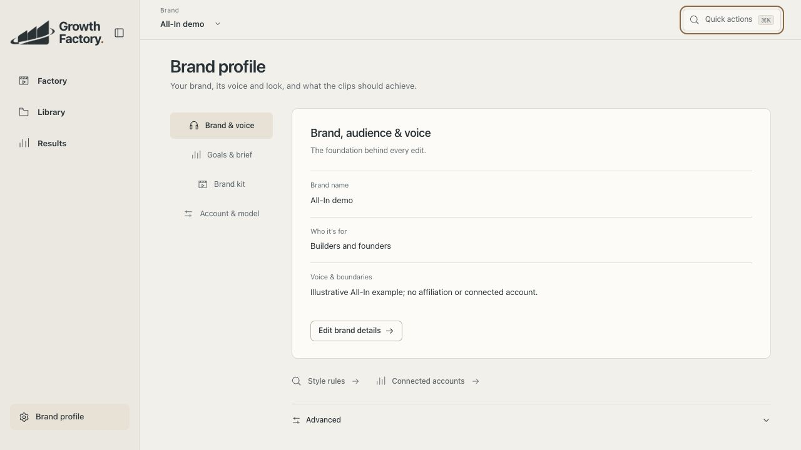
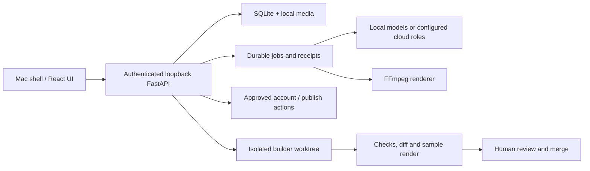

# Growth Factory

**An AI growth department for your computer (Mac, Windows and Linux), with a factory that can build its next editing tool.**

Give Growth Factory your brand, audience and footage. Agents find promising moments,
make captioned vertical drafts and prepare them for human review. Publication and
account results feed the next creative decision. When an editing capability is
missing, the factory can turn that gap into a coding work order, generate an
extension, run checks and a sample render, and present the change for human review.

Started at the **EVOLVE: 8090 AI Hackathon**; now a self-serve desktop subscription (Free, Pro $24 a month,
Business $200 a month). Video is the production line, posting to seven platforms; paid optimization is roadmap work.

> **Picking up the work?** Read [AGENTS.md](AGENTS.md), then the [handoff packet](docs/handoff/README.md) and
> [what is left](docs/handoff/outstanding-work.md).

[User guide](docs/guide/README.md) · [Submission guide](docs/submission/README.md) · [Project story](docs/submission/devpost.md) ·
[Run locally](#run-on-an-apple-silicon-mac) · [Engine](docs/engine.md) ·
[Factory builder](docs/factory-builder.md) · [Third-party notices](docs/third-party-notices.md)



*Pearl Studio interface with illustrative data. A UI preview is separate from a real
render, published post or measured audience result.*

## Two connected loops

**Creative work:** brand direction → source-backed drafts → human review → approved
publication → observations → proposed rule → next draft.

**Software building software:** missing edit capability → work order → generated
renderer extension and tests → static checks and sample render → human review →
reviewed integration. Generated code does not enter the running app automatically.

A documented builder rehearsal generated a `progress_bar` extension in a temporary
clone: **29 seconds, $0.0535 provider-reported cost, 12 generated tests and a sample
render passed**. Nothing from that rehearsal was pushed or merged. This is bounded
execution evidence, not a general reliability or cost benchmark.
[Builder evidence and constraints](docs/factory-builder.md#verified).

## What is implemented

| Area | Current capability |
| --- | --- |
| Brand setup | Website-assisted brand draft, source quotations, separately selected inferred suggestions, audience, voice, boundaries, goals and approved Style rules. Account sign-in or offline use. |
| Production | Local Whisper transcription, storyboard analysis, scout swarm or optional deeper team review, sentence-aware moments and best-first ranking. |
| Editing | Captioned 9:16 drafts, payoff teaser, title card, optional face-follow crop, measured jump cuts, loudness normalization, cover, brand styling and CTA. Available operations and fallbacks are [documented](docs/engine.md). |
| Review | Exact-version playback, quality evidence, requested revisions, approval and verified exports. Library retains source/clip controls and explains files the local service keeps. |
| Publication | Human-approved posting to TikTok, Instagram, YouTube, Facebook, LinkedIn, X and Threads through the Growth Factory posting server (Zernio): connected accounts, per-platform captions, scheduling and durable attempt reconciliation. **First real app publication still requires live verification.** |
| Plans and billing | Free, Pro and Business plans bought in the app through Stripe Checkout; plan limits enforced by the engine and the cloud; usage, upgrade prompts and Manage billing in Settings. See [billing](docs/billing.md). |
| Learning | Saved observations, three-/six-day windows while open, cited one-variable proposals, unapproved revised drafts, Strategist beliefs and a labeled synthetic simulation. |
| Builder | Capability requests, generated work orders, bounded extension generation/checks, review artifacts and an explicit draft-PR flow. Human merge and restart are required. |

The sidebar has **Factory, Library, Results, Brand profile and Settings**. Settings holds the device, models, speech,
connected accounts and the plan. The Activity Center shows jobs and posts, **⌘K / Ctrl+K** opens quick actions, and
**Help** opens the [user guide](docs/guide/README.md).

## Architecture and trust boundaries



- **Models choose; code measures and validates.** Scores help prioritize review;
  they do not certify truthfulness, predict engagement or grant publication permission.
- **Local-first with optional cloud processing.** OpenRouter roles send their inputs
  to the selected provider; still-frame sharing is opt-in. Publishing uploads the
  approved media. Credentials use native Keychain.
- **Evidence stays distinct.** A rendered file, technical check, human approval,
  provider receipt and audience result are different states. Synthetic metrics stay
  labeled; missing metrics stay unknown.
- **Human control remains explicit.** An agent's critique is not approval. Unknown
  publication outcomes require reconciliation. Generated extensions require review.

## Run on an Apple Silicon Mac

Prerequisites: native Python 3.11/3.12, Node 22.12+ recommended, and FFmpeg/ffprobe for
real media work. Setup and model/runtime installation are separate steps.

```sh
git clone https://github.com/MaxtheN/theclipfactory.git
cd theclipfactory
bash scripts/setup-mac.sh
.venv/bin/clip-factory
```

You can also open **Start Clip Factory.command** in Finder. Use the app's engine
setup for runtime and model readiness. Model licenses, memory and disk requirements
must be reviewed before downloading. Optional cloud and Instagram actions need their
own configured credentials/accounts. [Full setup, privacy and distribution notes](docs/development.md).

The source launch is the reproducible entry point. The Mac packaging workflow makes
an **ad-hoc-signed, unnotarized artifact**, not a verified public release. A clean-Mac
installation and current release download remain separate acceptance gates.

## Run on Windows 10/11 (x64)

Install with **`growth-factory-windows-x64-setup.exe`** from the *Build Windows and Linux
desktop apps* workflow. It installs for your user only (no administrator rights), adds a
Start menu shortcut, and installs Microsoft Edge WebView2 if it is missing. FFmpeg with
caption support is included. The beta installer is **unsigned**, so Windows SmartScreen
warns first: choose **More info → Run anyway** only for an installer whose source you trust.

From source (Python 3.11–3.13 x64, Node 22.12+):

```powershell
git clone https://github.com/MaxtheN/theclipfactory.git
cd theclipfactory
powershell -ExecutionPolicy Bypass -File scripts\setup-windows.ps1
.venv\Scripts\clip-factory.exe
```

## Run on Linux (x64)

Download **`growth-factory-linux-x86_64.AppImage`** from the same workflow, then
`chmod +x growth-factory-linux-x86_64.AppImage` and open it. It needs glibc 2.35 or newer
(Ubuntu 22.04, Debian 12, Fedora 36 or later) and a desktop session. FFmpeg and the app window
(Qt WebEngine) are included, so no WebKitGTK is needed. Saving API keys needs a Secret Service
key store such as GNOME Keyring or KWallet.

From source (Python 3.11–3.13, Node 22.12+):

```sh
git clone https://github.com/MaxtheN/theclipfactory.git
cd theclipfactory
bash scripts/setup-linux.sh
.venv/bin/clip-factory
```

On both systems, speech runs locally and the agents use Ollama; the app's Settings → Models
walks through each step. [Windows and Linux packaging notes](docs/development.md#packaged-windows-installer-and-linux-appimage).

## Verify

```sh
python -m pip install -e '.[test]' 'setuptools>=75' wheel
python -m pytest tests scripts/tests -q
python -m ruff check clip_factory scripts
(cd frontend && npm ci && npm test && npm run build)
```

Vitest uses two workers to keep full-app jsdom tests within laptop/CI resource
budgets. Automated checks do not replace actual media review, account verification
or a real publication rehearsal. Current proof and outstanding gates are in the
[submission evidence ledger](docs/submission/evidence.md).

## Current limits

Fresh clip selection, semantic accuracy, captions and audio still need human review.
The first real post through the current publishing flow and the full subsequent
measurement/learning cycle are live gates. Organic comparisons do not prove causal
lift. Schedules/collection require the app open; cloud state synchronization,
always-on workers, paid activation, general B-roll/music mixing and notarized
release distribution are not claimed here. New closed-loop/scoring work on an
uncommitted checkout is not part of a published revision until reviewed and merged.

## Event disclosure and attribution

**Pre-event work:** the team confirmed on November 14, 2026 that no project code,
prototype, design or templates existed before EVOLVE. The first repository commit
is dated November 13, 2026. Third-party libraries, pretrained models and development
tools are disclosed separately; their use is not presented as original team work.

**Stack and tools:** Python, FastAPI, Uvicorn, SQLite, React, TypeScript, Vite,
pywebview, FFmpeg, MLX/Whisper, Ollama/Qwen, Composio, OpenRouter, Supabase and Vercel.
Development used AI coding assistants and 8090 Software Factory work orders/review
records. [Third-party notices](docs/third-party-notices.md) list licenses and service
terms separately. Sponsor selections should reflect actual use; no ElevenLabs
feature is claimed by this submission.

**License:** see [LICENSE](LICENSE) for this project's MIT terms. Third-party code,
models, media and services retain their respective licenses and terms.

## Documentation

- [User guide](docs/guide/README.md): how to use every part of the app (also opened from **Help** in the app)
- [Submission checklist and field mapping](docs/submission/README.md)
- [Devpost project story](docs/submission/devpost.md), [field-ready copy](docs/submission/fields.md), [judge Q&A](docs/submission/judge-qa.md)
- [Two-minute demo](docs/submission/demo-script.md) and [video storyboard](docs/submission/video-storyboard.md)
- [Engineering handoff](docs/HANDOFF.md), [finish line](docs/finish-line.md), [roadmap](docs/product-roadmap.md)
- [API contract](API_CONTRACT.md), [engine](docs/engine.md), [publishing](docs/instagram-publishing.md), [learning](docs/learning-loop.md), [Strategist](docs/strategist.md)
- [Mac setup and development](docs/development.md), [Mac acceptance](docs/mac-testing.md), [third-party notices](docs/third-party-notices.md)
