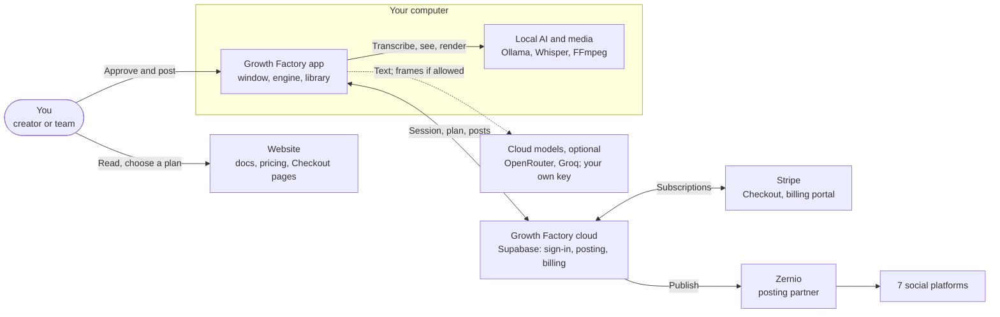
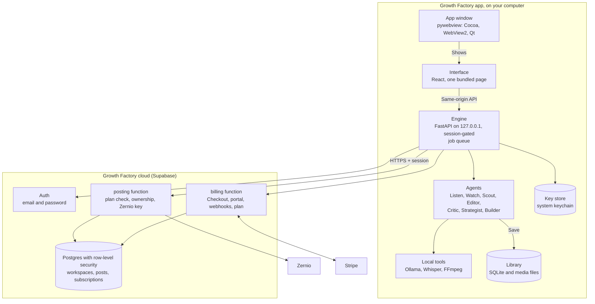
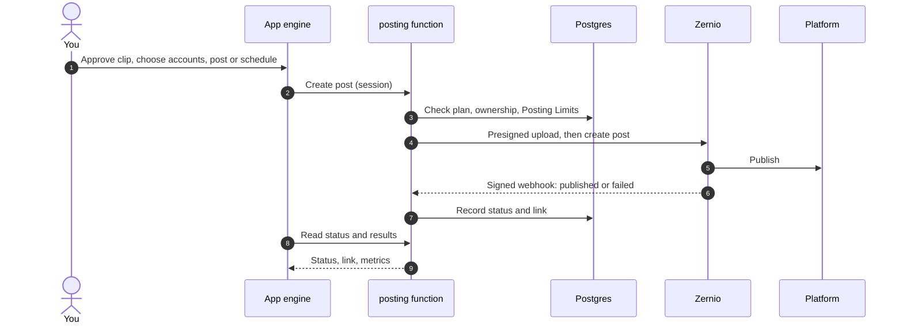
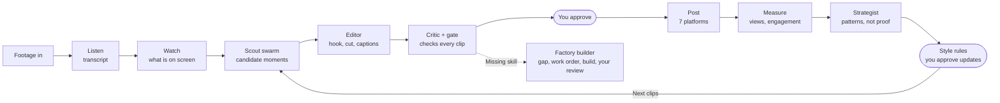
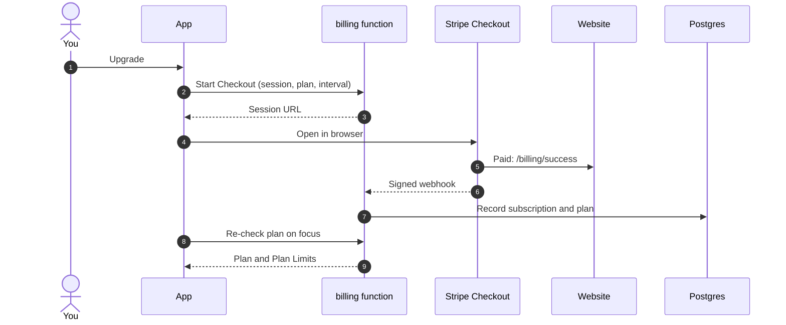

# Architecture

How Growth Factory fits together, in five diagrams. The same diagrams, drawn for the web, are on the website's [architecture page](https://growth-factory-landing.vercel.app/architecture); their source is `landing-page/site/diagrams.mjs`. Keep the two in step when the system changes.

Deeper references: [cloud state](cloud-state.md), [posting server](posting-server.md), [billing](billing.md), and the [user guide](guide/README.md).

## System context

The app does the heavy work on your computer and keeps your library there. It talks to the Growth Factory cloud only for sign-in, posting and billing, and to cloud models only if you add your own key.

## Containers

Inside the app, a native window shows the React interface, which calls the engine on `127.0.0.1` with a per-launch session. The engine runs one heavy job at a time. In the cloud, two Supabase Edge Functions hold the only Zernio and Stripe secrets, and every table has row-level security.

## Posting flow

Only an approved clip can be posted. The engine asks the posting function, which checks the plan and ownership, uploads the media to Zernio and creates the post. Zernio's signed webhooks record the outcome, and the engine reads status and results back. Details: [posting server](posting-server.md).

Scheduled posts are sent by the app at their time, so the app must be open; a missed time waits for you instead of posting late.

## Learning loop

Every clip is checked before you see it, and nothing posts or changes your Style rules without your approval.

## Billing flow

The app opens Stripe Checkout in your browser. Stripe's signed webhook is the only thing that changes a plan; the return pages on the website just tell you to go back to the app, which re-checks the plan. Details: [billing](billing.md).

## Principles

- **Local first.** Media, models and the library stay on your computer; cloud use is named before it happens.
- **Approval gates.** Export, posting and Style rules changes all need your approval of the exact revision.
- **Secrets stay server-side.** The Zernio and Stripe keys live only in the cloud functions; the app holds a publishable key and your session.
- **Row-level security everywhere.** Every cloud table is scoped to its workspace, with SQL probes in `supabase/tests/`.
- **Plans are data.** One catalog drives the app, the functions and the website, and tests keep them equal.
- **Nothing is deleted on a downgrade.** Limits block creating more, never what you already have.
